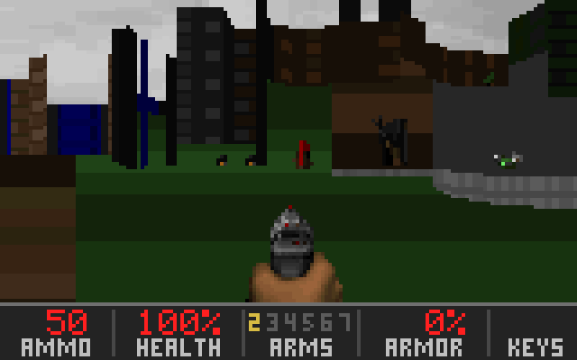
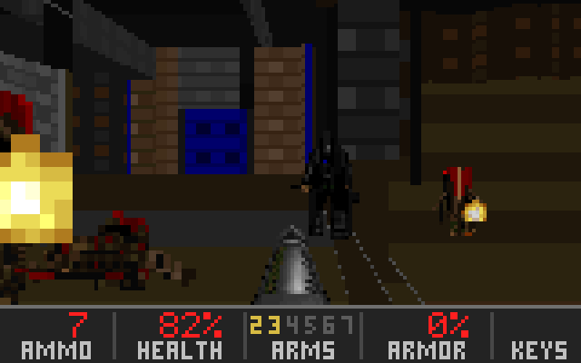
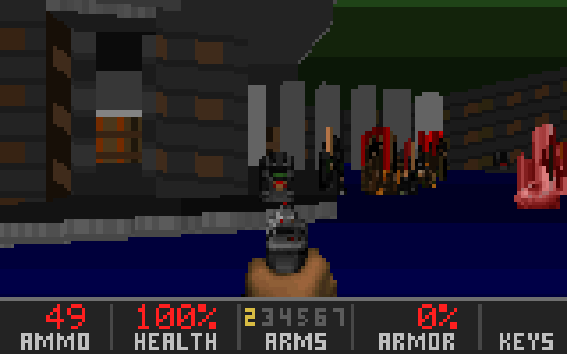
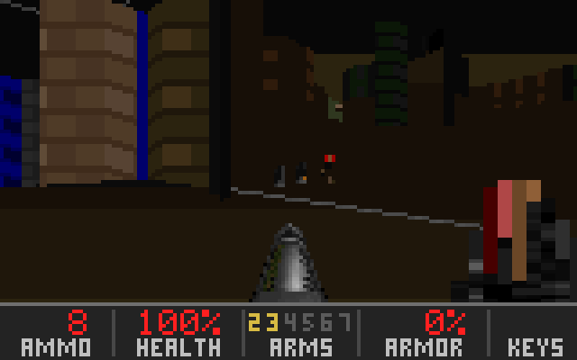
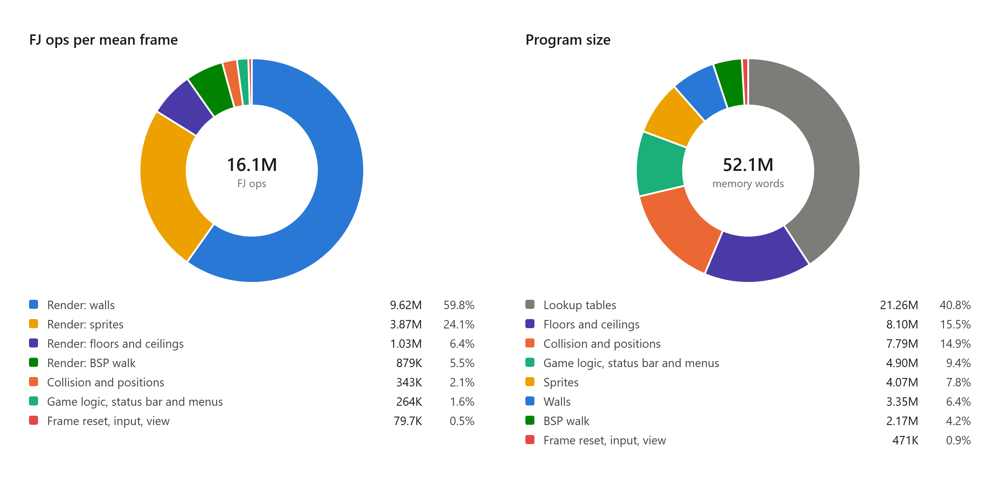

<h1 align="center">DOOM on FlipJump</h1>

<p align="center"><b>FlipJump has exactly one instruction: flip a bit, then jump to the next opcode.<br>This is DOOM running on it.</b></p>

<p align="center">
  
</p>

<p align="center">
  <a href="https://github.com/tomhea/doom-flipjump/actions/workflows/ci.yml"></a>
  <a href="LICENSE"></a>
  <a href="https://pypi.org/project/flipjump/"></a>
  
  <a href="https://esolangs.org/wiki/FlipJump"></a>
  <a href="https://github.com/tomhea/doom-flipjump/stargazers"></a>
</p>

FlipJump's only instruction is `a;b`: **flip** the bit at address `a`, then **jump** to address `b`.
No registers, no arithmetic, no conditional branch, no load or store. Everything else, including
"if", is built by flipping bits inside the address of the next jump.

This repository builds a 52-million-word FlipJump program that renders Freedoom's first level with
textured walls, floors and ceilings, doors and lifts, monsters that hunt and fight back, six
weapons on five keys up to a rocket launcher, damage, death, a menu and an automap, at 160x100, around 15 frames a second on the native FlipJump
interpreter.

<p align="center">
  
  
  
</p>
<p align="center"><sub>Every picture on this page was rendered by the project's Python oracle replaying a frozen combat
scenario. The shipped binary draws byte-identical frames on every frame of those runs (the B0 gate on the frozen v10 set, 2026-10-18,
<a href="docs/ship-gate.md">ship-gate.md</a>).</sub></p>

## Try it

```bash
pip install "flipjump[io]"
curl -LO https://github.com/tomhea/doom-flipjump/releases/latest/download/doom.fjm
fj --run doom.fjm
```

Three lines: the FlipJump interpreter, the game (one file), and a window with the menu. Press
**Enter** on NEW GAME. The file carries its own run settings (the screen device and the flat memory
flag are in its header), so there is nothing else to type.

Also possible, with nothing to install: `uvx fjdoom`.

Until the 1.0 release is out, none of the three lines works yet: flipjump 1.5.1 is not on PyPI, the
file does not exist and the `fjdoom` package is not published. [docs/developing.md](docs/developing.md)
says how to build it today.

- Needs Python 3.10 to 3.13, a display, and about 1 GB of free RAM. Prebuilt interpreter wheels
  exist for Windows, macOS (Intel and Apple silicon) and Linux (x86-64 and ARM).
  <!-- TODO: measure cold start time and the download size; state both here. -->
- Windows PowerShell 5 aliases `curl` to its own command: type `curl.exe` there, or save the file
  from the [release page](https://github.com/tomhea/doom-flipjump/releases/latest), which also
  lists its SHA-256.
<!-- The quotes around flipjump[io] are for zsh (macOS's default shell), where [io] is a glob.
     The PyPI name `fj` is taken by an unrelated package, so the install line stays `flipjump`. -->
<!-- Line 3 relies on flipjump 1.5.1's fjm header: io_mode (pc) and run_flags (flat memory) are written
     at assembly (`--io-mode 1 --run-flags 1`, or assemble(io_mode=, run_flags=)) and `fj --run` honours
     them; `--io` / `--run-flags` override. `--run` itself stays: `fj file` assembles. The release's
     doom.fjm must be built WITH those two header fields (docs/launch-plan.md step 5). -->
<!-- TODO (optional, after launch): standalone executables on the Release page for people without
     Python (PyInstaller, one per OS). Unsigned builds trip SmartScreen and Gatekeeper; say so. -->

| Key | Action |
|---|---|
| W / S, or the up / down arrows | move forward / back |
| left / right arrows | turn |
| A / D, or , / . | strafe |
| Ctrl | fire |
| 1 2 3 4 5 | weapons (1 is the fist or the chainsaw, 5 the rocket launcher) |
| Space or E | use (opens doors) |
| H | help screen |
| M | the map |
| Enter / Esc | menu (RESUME, NEW GAME, HELP, MAP, EXIT) |

## What you are looking at

**The whole game is one FlipJump program.** The `.fjm` file is a memory image: 52 million 32-bit
words, each a flip address or a jump address. At runtime the interpreter does nothing but this,
about 16 million times per frame:

```c
/* flipjump/interpreter/_fjcore.c, the fetch-flip-jump loop, paraphrased for w = 32 (addresses are bit addresses) */
for (;;) {
    f = mem[ip];                        /* read the flip word            */
    mem[f >> 5] ^= 1u << (f & 31);      /* flip one bit                  */
    ip = mem[ip + 1];                   /* jump                          */
}
```
<!-- TODO: link to the literal loop at the 1.5.1 tag (_fjcore.c, the `for (;;)` at ~line 1089). -->

The screen is a memory-mapped output device and the keyboard a memory-mapped input device. Nothing
else runs: no Python, no C game logic, no hidden renderer. The interpreter is open and about two
thousand lines; the loop above is all it does per op.

**Python wrote the program; it does not run it.** The toolchain in `src/doomfj/` is a compiler. It
reads a DOOM-format WAD and compiles the level's BSP tree, textures, flats, sprites, light tables and
the game rules into FlipJump source, millions of lines of it, which the FlipJump assembler turns
into the memory image. That happens once, on a build machine, in about 45 minutes with about
10 GB of RAM. <!-- TODO: blocked62's exact source size, build time and peak RSS. --> Players never
run it.

**How a one-instruction machine renders anything.** A FlipJump "if" is a jump whose target address
had a bit flipped by earlier code. Arithmetic is lookup tables laid out in the address space so that
reading a table entry *is* flipping the right bits of the next jump. Everything from `x + y` to "which
wall is in front of this column" is built that way, from FlipJump's standard library upward.
[DESIGN.md](DESIGN.md) is the long version.

**What a frame does.** Read the keyboard, run the game tic (movement, collision, doors, monster AI,
projectiles, damage), walk the level's BSP tree front to back, draw walls, floors, ceilings and
sprites into a 160x84 view with a 16-row status bar under it, present the frame, then reset: the
program is self-modifying, so it ends every frame by restoring the words it dirtied and jumping back
to its start.

**Every pixel is cross-checked.** A Python reference model, `src/doomfj/reference_model.py`,
simulates and renders the same frame independently. The FlipJump build must match it **byte for
byte**, with instruction counts equal to the digit, on frozen scenario sets, before it ships. No
number below rests on anyone's word; each row names the command that produced it.

## The numbers

<p align="center">
  
</p>
<p align="center"><sub>Left: a mean frame of the benchmark tours. Drawing walls is 60% of it and sprites 24%; all the game logic, the
status bar and the menus together are 1.6%. Right: the program. Lookup tables are 41% of it, which is the whole
trick: arithmetic is read, not computed. Measured on blocked62; the shipped blocked63 adds the map page, +0.3%.</sub></p>

| | |
|---|---|
| instructions in the language | 1 |
| the program | 52.3 million words, 39.8 MB; 39% of the largest address space the interpreter allows |
| one frame | about 16 million flip-jumps; up to 28 million in the heaviest fight |
| speed | 68 ms a frame, about 15 fps, on one core, at 233 million flip-jumps per second |
| a 32-bit addition | about 800 flip-jumps, so a pixel costs about one addition |
| the screen | 160 x 100, 256 colours, a 16-row status bar |
| the check | every frame of eleven scripted fights identical, pixel for pixel, to the Python model |
| the build | one pass, about 45 minutes, about 10 GB of RAM |

Every number comes from the record of the shipped build, `doom_e1m1_blocked63.fjm`
(SHA-256 `b65e5a97...994120c`), where each stands next to the command that produced it:
[docs/ship-gate.md](docs/ship-gate.md). For scale: DOOM on a 486DX2-66 spent about thirty
instructions per pixel. [The story](docs/story.md) has the arithmetic.

## Questions people ask

**Is Python drawing the pixels?** No. At runtime only the interpreter runs, and it knows nothing
about DOOM: the window is a generic FlipJump output device (the `pc` io mode, named in the file's
header) that shows whatever the program writes to it. The same `.fjm` runs, slowly, under the pure-Python interpreter.

**Is this the real DOOM?** It is a DOOM engine: the BSP renderer, the WAD format and the game rules
re-implemented from the published sources. The level and the art are
[Freedoom](https://freedoom.github.io/)'s (BSD-licensed), because id Software's assets cannot be
redistributed. What you play is Freedoom Phase 1's E1M1, not id's. The compiler takes any
DOOM-format WAD as input. <!-- TODO: either test a build from doom1.wad before launch and describe it here, or delete this sentence. -->

**How was it built?** <!-- TODO owner: this is the paragraph HN reads first; edit it in your own words. -->
Over four months, June to October 2026, with Claude Code (Anthropic's coding agent) writing most of
the implementation. The language, its interpreter, the architecture, the goals and every decision
are the author's. The process was designed so that nothing rests on trust: an independent Python
oracle, byte-exact gates with instruction counts to the digit, a written review contract for every
change ([docs/cr-rules.md](docs/cr-rules.md)), and a rule that any measurement quoted as proof ships
with a negative control. The whole record, including every per-milestone handoff, is in `docs/`.

**Why 160x100 and 15 fps?** Cost is counted in flip-jumps and a frame is 14 to 16 million of them,
at 233 million per second on one core. DOOM's native width is 320; 160 halves the per-frame work and
is what fits the 2^27-word address space with room for the game. What was tried, kept and closed
on the way is in [docs/ship-gate.md](docs/ship-gate.md).

**Can I play it in the browser?** Not yet. The interpreter is C; a WebAssembly build is the open item.

**Can I build it myself?** Yes: [docs/developing.md](docs/developing.md). It wants about 10 GB of RAM
and about 45 minutes.

## The story, in sixty seconds

I made FlipJump five years ago to prove that one instruction is enough for anything. A year and a
half ago I wrote a C-to-FlipJump compiler and showed on Hacker News that DOOM could run on it in
theory. In practice it could not: one line of C became hundreds to thousands of flip-jumps, and a
frame would have taken seconds. I shelved the dream.

In June 2026 two things happened in the same week. A friend gave a talk about running DOOM on his
water dispenser, and I started using a coding agent. Months suddenly looked possible. The
arithmetic set the terms: about 200 million flip-jumps per second, 800 of them for one 32-bit
addition, so a 320x200 frame at 25 fps would leave 125 flip-jumps per pixel, a sixth of an addition.
The screen became 160x100 and the target 13 frames a second.

The first frame cost a billion flip-jumps. Four months of lookup tables, a BSP tree compiled into
code, a program that resets itself every frame, and a Python oracle that every frame had to match
byte for byte brought a frame with monsters down to about sixteen million. The long version, with
the numbers, the dead ends and what Claude did and did not do: **[docs/story.md](docs/story.md)**.

## How it works, in one screen

- The instruction, the assembler and the standard library: the [FlipJump repository](https://github.com/tomhea/flipjump)
  and its [docs](https://fjdocs.tomhe.app); the [esolangs page](https://esolangs.org/wiki/FlipJump).
- Architecture, memory map, the per-frame pipeline: [DESIGN.md](DESIGN.md).
- The BSP walk compiled to code, the two-pass renderer, the self-resetting frame loop, doors, the
  menu, the keyboard device: the `docs/handoff-*.md` files, one per milestone.
- The verification contract: [docs/cr-rules.md](docs/cr-rules.md) (rules R1 to R9) and the ship
  gate, [docs/ship-gate.md](docs/ship-gate.md).
- Why addresses matter: an op costs as many flips as the popcount of what it flips, so flipjump
  1.5.1's table-placement and blocking passes put lookup tables at low-popcount addresses.
- The generated program's parts, in load order: entry, tables, main, segment constants, the BSP
  walk, state, the sprite and texture banks, reset.
- Building and testing it yourself: [docs/developing.md](docs/developing.md).

## Credits and license

- The code is BSD-2-Clause, see [LICENSE](LICENSE).
- The game image contains the level and art of Freedoom 0.13.0, copyright the contributors to the
  Freedoom project, BSD-3-Clause. <!-- TODO: copy Freedoom's notice verbatim here and into the Release. -->
- DOOM is id Software's. This project re-implements the engine's algorithms from the published
  sources and ships no id assets.
- FlipJump (the language, assembler, interpreter and standard library) is by Tom Herman. The window
  is pygame-ce.
